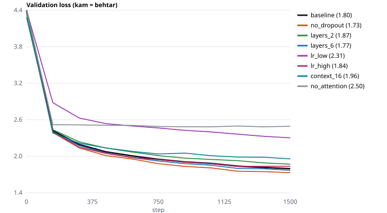

# mini-GPT

Shuru se banaya hua ek chhota GPT (decoder-only transformer), character-level, PyTorch mein.
Ye seekhne ke liye hai: har line ke saath Roman Urdu comments hain.

## Files

| File | Kya karti hai |
|---|---|
| `data.py` | Text → numbers (character tokenizer), train/val split, batches (`x` aur ek aage shift kiya `y`) |
| `bigram.py` | Step 1: sab se simple model, attention ke baghair. Iska loss baseline hai |
| `gpt.py` | Step 2: asli transformer (embeddings → 4 blocks [LayerNorm → causal multi-head attention → MLP, residuals] → logits) aur training loop |
| `sample.py` | Trained `model.pt` se text likhwana |
| `experiments.py` | Hyperparameters badal kar kai models train karna aur compare karna (table + chart) |
| `data/input.txt` | Tiny Shakespeare (~1.1 MB), [karpathy/char-rnn](https://github.com/karpathy/char-rnn) se |

## Chalana

```bash
pip install -r requirements.txt
python3 bigram.py            # baseline, ~5 second
python3 gpt.py               # GPT training, 3000 steps
python3 sample.py --prompt "ROMEO:" --temp 0.8
```

Mac par khud Apple GPU (`mps`) use hota hai, NVIDIA par `cuda`, warna CPU.

## Pehli training ke nateeje (Mac, MPS)

| Model | Parameters | Val loss | Waqt |
|---|---|---|---|
| Random guess | – | 4.17 (ln 65) | – |
| Bigram | 4K | ~2.49 | ~5s |
| mini-GPT (4 layers, 4 heads, d=128) | 0.82M | **1.665** | ~65s, 3000 steps |

GPT ka text (`--prompt "ROMEO:" --temp 0.7`):

```
ROMEO:
Then, and good this and heart, their states stoods and my brother,
Nor wondren the recome, burt and the hath house.

GREGORY:
I had come of the hunds and all the cousin.
```

Lafz zyada tar asli hain aur drama ka format (naam, colon, lines) seekh liya hai, lekin matlab abhi nahi.
Zyada steps aur bada model is ko aur behtar karte hain.

## Experiments: kis cheez ka kya asar hai

`python3 experiments.py` baseline se har baar sirf **ek** cheez badal kar 8 models train karta hai
(har ek 1500 steps, Mac MPS, ~4.5 minute). Poori table: [`experiments/results.md`](experiments/results.md).



| Experiment | Val loss | vs baseline | Seekh |
|---|---|---|---|
| `no_dropout` | 1.731 | −0.065 | Itni chhoti training mein model abhi overfit nahi hota, is liye dropout sirf seekhna dheema karta hai. Lambi training ya bade model mein ye faida deta hai |
| `layers_6` | 1.769 | −0.028 | Gehra model thora behtar hai, lekin 22% zyada waqt leta hai |
| `baseline` | 1.796 | – | 4 layers, d=128, context 64, dropout 0.1, lr 1e-3 |
| `lr_high` (1e-2) | 1.837 | +0.040 | Zyada LR se nuksaan hua, lekin Adam ki wajah se model phata nahi |
| `layers_2` | 1.870 | +0.074 | Kam gehrai = kam samajh |
| `context_16` | 1.958 | +0.162 | Sirf 16 characters ka context: lafz aur lines ka andaaz pakadna mushkil |
| `lr_low` (1e-4) | 2.305 | +0.509 | Bohat dheema: 1500 steps mein abhi seekh hi raha hai (curve ab bhi neeche ja rahi hai) |
| `no_attention` | 2.496 | +0.699 | **Attention ke baghair model bigram (2.49) jitna hi reh jata hai.** Har token sirf khud ko dekhta hai, is liye MLP bhi pichle text se kuch nahi seekh sakta. Transformer ki asli taqat attention hai |

Note: har experiment ek hi seed se chala hai. ~0.03 se kam farq shor (noise) bhi ho sakta hai.

## Apne experiments

`gpt.py` mein `Config` badlo aur dekho loss par kya asar hota hai:

- `n_layers` ya `d_model` barhao: model bara, loss kam, lekin dheema
- `block_size` barhao: zyada pichla context dikhta hai
- `dropout = 0`: train loss aur val loss ka farq (overfitting) barhta dikhega
- `--lr 3e-3` ya `--lr 1e-4`: bohat zyada ya bohat kam learning rate ka asar
- Apna text `data/input.txt` mein daalo (jaise Roman Urdu shayari), aur model usi ke andaaz mein likhega

`losses.csv` mein har eval ka train/val loss save hota hai.
