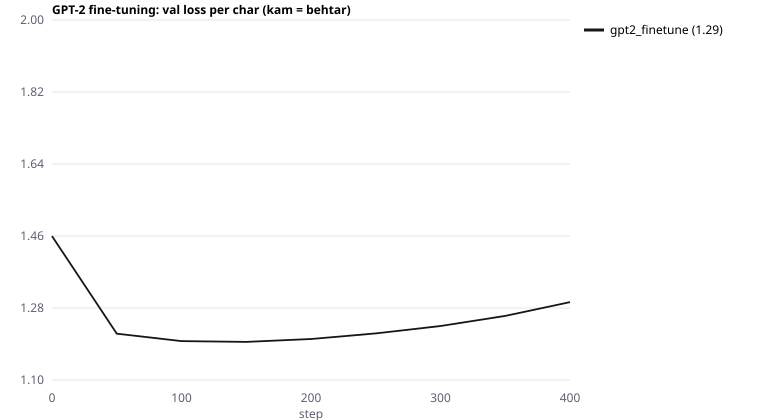

# mini-GPT

Shuru se banaya hua ek chhota GPT (decoder-only transformer), character-level, PyTorch mein.
Ye seekhne ke liye hai: har line ke saath Roman Urdu comments hain.

## Files

| File | Kya karti hai |
|---|---|
| `data.py` | Text → numbers (character tokenizer), train/val split, batches (`x` aur ek aage shift kiya `y`) |
| `bigram.py` | Step 1: sab se simple model, attention ke baghair. Iska loss baseline hai |
| `gpt.py` | Step 2: asli transformer (embeddings → 4 blocks [LayerNorm → causal multi-head attention → MLP, residuals] → logits) aur training loop |
| `sample.py` | Trained `model.pt` se text likhwana |
| `tokenization.py` | Tokenizers: character, apna seekha hua BPE (shuru se), aur GPT-2 ka asli tokenizer. `python3 tokenization.py` BPE ke merges dikhata hai |
| `compare_tokenizers.py` | Same model ko 5 tokenizers ke saath train karke muqabla |
| `finetune.py` | Step 3: pretrained GPT-2 (124M) ko Shakespeare par fine-tune karna (partial fine-tuning + early stopping) |
| `experiments.py` | Hyperparameters badal kar kai models train karna aur compare karna (table + chart, `--seeds` se shor bhi naapta hai) |
| `data/input.txt` | Tiny Shakespeare (~1.1 MB), [karpathy/char-rnn](https://github.com/karpathy/char-rnn) se |

## Chalana

```bash
pip install -r requirements.txt
python3 bigram.py            # baseline, ~5 second
python3 gpt.py               # GPT training, 3000 steps
python3 sample.py --prompt "ROMEO:" --temp 0.8
python3 gpt.py --tokenizer bpe1024   # BPE tokens ke saath train karo
python3 finetune.py                  # pretrained GPT-2 ko fine-tune karo (~5 minute, CPU)
```

Mac par khud Apple GPU (`mps`) use hota hai, NVIDIA par `cuda`, warna CPU.

## Pehli training ke nateeje (Mac, MPS)

| Model | Parameters | Val loss | Waqt |
|---|---|---|---|
| Random guess | – | 4.17 (ln 65) | – |
| Bigram | 4K | ~2.49 | ~5s |
| mini-GPT (4 layers, 4 heads, d=128) | 0.82M | **1.665** | ~65s, 3000 steps |

GPT ka text (`--prompt "ROMEO:" --temp 0.7`):

```
ROMEO:
Then, and good this and heart, their states stoods and my brother,
Nor wondren the recome, burt and the hath house.

GREGORY:
I had come of the hunds and all the cousin.
```

Lafz zyada tar asli hain aur drama ka format (naam, colon, lines) seekh liya hai, lekin matlab abhi nahi.
Zyada steps aur bada model is ko aur behtar karte hain.

## Experiments: kis cheez ka kya asar hai

`python3 experiments.py` baseline se har baar sirf **ek** cheez badal kar 8 models train karta hai
(har ek 1500 steps, Mac MPS, ~4.5 minute). Poori table: [`experiments/results.md`](experiments/results.md).


| Experiment | Val loss | vs baseline | Seekh |
|---|---|---|---|
| `no_dropout` | 1.731 | −0.065 | Itni chhoti training mein model abhi overfit nahi hota, is liye dropout sirf seekhna dheema karta hai. Lambi training ya bade model mein ye faida deta hai |
| `layers_6` | 1.769 | −0.028 | Gehra model thora behtar hai, lekin 22% zyada waqt leta hai |
| `baseline` | 1.796 | – | 4 layers, d=128, context 64, dropout 0.1, lr 1e-3 |
| `lr_high` (1e-2) | 1.837 | +0.040 | Zyada LR se nuksaan dikha, lekin 3 seeds par ye farq shor nikla (neeche dekho) |
| `layers_2` | 1.870 | +0.074 | Kam gehrai = kam samajh |
| `context_16` | 1.958 | +0.162 | Sirf 16 characters ka context: lafz aur lines ka andaaz pakadna mushkil |
| `lr_low` (1e-4) | 2.305 | +0.509 | Bohat dheema: 1500 steps mein abhi seekh hi raha hai (curve ab bhi neeche ja rahi hai) |
| `no_attention` | 2.496 | +0.699 | **Attention ke baghair model bigram (2.49) jitna hi reh jata hai.** Har token sirf khud ko dekhta hai, is liye MLP bhi pichle text se kuch nahi seekh sakta. Transformer ki asli taqat attention hai |

Note: ye table ek hi seed se hai. Neeche wala seeds experiment batata hai kaunse farq pakke hain.

### Kaunse farq asli hain? (3 seeds)

`python3 experiments.py --seeds 3 --only baseline no_dropout layers_6 lr_high --out-dir experiments/seeds`
har experiment ko 3 alag seeds (alag shuruaati weights aur batches) se chalata hai.
Poori table: [`experiments/seeds/results.md`](experiments/seeds/results.md).

| Experiment | Val loss (mean ± std) | vs baseline | Pakka? |
|---|---|---|---|
| `no_dropout` | 1.730 ± 0.001 | −0.062 | haan |
| `layers_6` | 1.761 ± 0.007 | −0.031 | haan |
| `baseline` | 1.793 ± 0.006 | – | – |
| `lr_high` | 1.813 ± 0.009 | +0.020 | shayad shor |

- Seed badalne se hi val loss ~0.006 tak hil jata hai. Is se chhota farq kuch sabit nahi karta.
- `no_dropout` aur `layers_6` ka faida asli hai: shor se kai guna bada.
- `lr_high` ka nuksaan ek seed par +0.040 dikha tha, lekin 3 seeds ka average sirf +0.020 hai, jo shor ke andar hai.
  Seekh: **ek run se nateeja mat nikalo.** Asli research mein isi liye kai seeds chalaye jaate hain.

## Tokenizers: character vs BPE vs GPT-2

`python3 tokenization.py` apna BPE seekhta hai aur merges dikhata hai. Pehle merges hain `' ' + 't'`, `'h' + 'e'`, phir
`' t' + 'he' -> ' the'`. Yani wo khud dhoondta hai ke English mein kaunse tukre sab se aam hain.

Ek sentence (57 characters) har tokenizer mein:

- **char** (57 tokens): `R|O|M|E|O|:| |B|u|t| |s|o|f|t|,| …`
- **bpe1024** (22 tokens): `ROMEO|:| |But| so|ft|,| what| li|ght| thr|ough| y|ond|er| w|ind|ow| bre|ak|s|?`
- **gpt2** (14 tokens): `ROM|EO|:| But| soft|,| what| light| through| y|onder| window| breaks|?`

Mazedaar baat: hamare BPE ne `ROMEO` ko ek token banaya, kyunki is text mein wo bohat aata hai. GPT-2 ne internet
par seekha tha, is liye uske liye `ROMEO` nadir hai lekin ` through` aur ` window` aam hain.

`python3 compare_tokenizers.py`: same model (4 layers, d=128, context 64 *tokens*), 1500 steps, sirf tokenizer alag.
Poori report aur har model ka likha hua text: [`experiments/tokenizers/results.md`](experiments/tokenizers/results.md).

| Tokenizer | Vocab | Params | Embeddings ka hissa | Chars/token | Context (chars) | Val loss / token | **Val loss / char** | Waqt |
|---|---|---|---|---|---|---|---|---|
| `char` | 65 | 0.82M | 2% | 1.00 | ~64 | 1.770 | **1.770** | 32s |
| `bpe256` | 256 | 0.87M | 8% | 1.78 | ~114 | 2.941 | **1.649** | 31s |
| `bpe512` | 512 | 0.93M | 14% | 2.06 | ~132 | 3.304 | **1.607** | 30s |
| `bpe1024` | 1024 | 1.06M | 25% | 2.32 | ~148 | 3.647 | **1.572** | 31s |
| `gpt2` | 50,257 | 13.72M | 94% | 3.09 | ~198 | 4.817 | **1.557** | 608s |

Seekh:

1. **"Per token" loss se dhoka mat khao.** GPT-2 ka 4.817 char ke 1.770 se bura lagta hai, lekin uska har token
   ~3 characters ka hai. Insaaf se compare karne ke liye loss ko characters per token se taqseem karo.
2. **Bada vocab = behtar per-character loss** (1.770 → 1.557). Har token mein zyada maana hota hai, aur
   64 tokens ka context ~64 ki jagah ~198 characters dekh leta hai.
3. **Lekin qeemat hai.** GPT-2 vocab mein model ka 94% sirf embedding table hai, aur 50,257 words par softmax
   training ko ~20 guna dheema (608s) kar deta hai. Faida bpe1024 se sirf 0.015 hai, jo ek seed par shor bhi ho sakta hai.
   Chhote data aur model ke liye ~1000 tokens wala BPE sab se acha sauda hai.
4. BPE models naam bhi tukron se jod kar banate hain (jaise `CAMARGUMBILKE`): naya token nahi, purane tukre naye tareeqe se.

## Fine-tuning: pretrained GPT-2 vs shuru se

Ab tak har model random weights se shuru hua. `finetune.py` OpenAI ka GPT-2 small (124M parameters, ~40GB
internet text par trained) leta hai aur usay Shakespeare par thora aur sikhata hai. Poori report:
[`experiments/finetune/results.md`](experiments/finetune/results.md).

| Model | Val loss / char |
|---|---|
| Hamara sab se acha shuru se train kiya model (GPT-2 tokenizer, 13.7M) | 1.557 |
| **GPT-2, bina fine-tuning (zero-shot)** | **1.458** |
| GPT-2, 150 steps fine-tuning ke baad (sab se acha) | **1.194** |
| GPT-2, 400 steps ke baad | 1.293 |



Seekh:

1. **Pretraining sab se bada faida hai.** Shakespeare ka ek lafz dekhe baghair GPT-2 hamare har model se behtar tha.
   Sirf 150 steps (~100 second) ne loss 1.458 → 1.194 kar diya. Industry isi liye shuru se train karne ki jagah fine-tune karti hai.
2. **Partial fine-tuning.** 8 GB Mac par poore GPT-2 ki training memory ko swap mein dhakel deti thi (GPU par har step
   1s → 4s → 20s). Is liye sirf aakhri 4/12 blocks train kiye (124M mein se 28.4M), baaki "freeze". Neeche ki layers
   zabaan ki aam samajh rakhti hain, upar ki andaaz badalti hain. LoRA jaise tareeqe isi soch se nikle hain.
3. **Overfitting aur early stopping.** Val loss step 150 ke baad barhne laga (1.194 → 1.293) jabke train loss girta raha:
   model training wale dramon ke mutabiq zyada dhal gaya. `finetune.py` har eval par sab se acha model sambhalta hai aur
   aakhir mein wahi wapas lagata hai (aur dobara naap kar check karta hai).
4. **Loss sab kuch nahi batata.** Step 150 wala model loss mein sab se acha hai, lekin uske samples ab bhi aadhe internet
   jaise hain. Step 400 wala zyada "Shakespeare jaisa" likhta tha (`ROMEO: … CISULUS: O God, what has he done to me?`)
   lekin naye text par zyada galat tha. Andaaz ki nakal aur asli generalization alag cheezein hain.
5. **Repetition loop.** Ek sample `CISABELLA:` baar baar dohrata atak gaya. Chhote models ki aam kamzori hai;
   `repetition_penalty=1.2` (pehle aa chuke tokens ko thora kam pasand karna) se theek hota hai.

## Apne experiments

`gpt.py` mein `Config` badlo aur dekho loss par kya asar hota hai:

- `n_layers` ya `d_model` barhao: model bara, loss kam, lekin dheema
- `block_size` barhao: zyada pichla context dikhta hai
- `dropout = 0`: train loss aur val loss ka farq (overfitting) barhta dikhega
- `--lr 3e-3` ya `--lr 1e-4`: bohat zyada ya bohat kam learning rate ka asar
- Apna text `data/input.txt` mein daalo (jaise Roman Urdu shayari), aur model usi ke andaaz mein likhega

`losses.csv` mein har eval ka train/val loss save hota hai.
